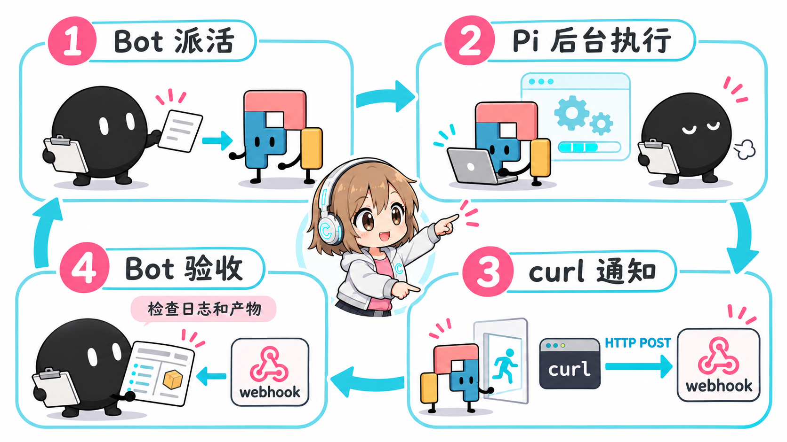

# GAP — Grokbot And Pi

Delegate heavy coding, batch file editing, and long document processing from Grok Bot to a local **Pi coding agent** ([pi.dev](https://pi.dev)) acting as a subagent, and wake the Bot up via Webhook upon completion for independent verification and reporting.

English | [简体中文](README.md)

---

## Architecture & Core Workflow



GAP operates as a clear 4-step closed loop:

1. **Bot Dispatches Task**: Grok Bot writes a concise task specification with strict boundaries and starts the task in the background using `pi-task run` without blocking the conversation;
2. **Pi Executes in Background**: Pi operates as a local, lightweight, headless coding agent performing code and file operations while the Bot ends its turn and waits;
3. **curl Notification**: **Upon task completion, `pi-task` automatically triggers an HTTP POST notification to the configured Webhook URL** (the payload contains only `{source, id, owner, state, exit_code}`, without sensitive text or tokens);
4. **Bot Acceptance**: The Webhook wakes Grok Bot's routine. The Bot runs `pi-task pending --owner <BOT_ID>` to read the task status and `result.md`, independently inspects logs, diffs, and generated artifacts, and reports the verified outcome to the user before sending an `ack`.

> **Disk is the Source of Truth**: Webhook notifications optimize latency. If a notification packet is dropped, the Bot recovers all unreported outcomes simply by running `pi-task pending --owner <BOT_ID>` on its next wake-up.

---

## Quick Start

Send the repository URL to your Grok Bot and let it configure itself using [AGENTS.md](AGENTS.md):
```text
Please read https://github.com/Chasen-Liao/grokbot-and-pi AGENTS.md and configure GAP for me.
```

### Manual Installation

If you prefer to install manually:

```bash
# 1. Ensure Node.js >= 22 and install the Pi CLI globally
npm i -g @earendil-works/pi-coding-agent

# 2. Clone this repository and run the installer (installs to ~/tools/pi-call)
git clone https://github.com/Chasen-Liao/grokbot-and-pi /tmp/grokbot-and-pi
cd /tmp/grokbot-and-pi && ./install.sh

# 3. Configure model quota and Webhook routine
# - Quota options: see docs/quota.md
# - Webhook routine template: see routines/pi-task-notify.md
# - Skills: see skills/grokbot-pi-setup and skills/grokbot-pi-dispatch
```

---

## Differences from Upstream (grokbot-local-agent)

This project is built upon and improved from [robbin/grokbot-local-agent](https://github.com/robbin/grokbot-local-agent):

1. **Flexible Provider & Native Pi Default Model**: Removed hardcoded gateway defaults; supports `--model` and `PI_TASK_MODEL`. When omitted, Pi uses its own locally configured default model and quota;
2. **Multi-Bot Notification Isolation (`--notify-prefix <NAME>`)**: Supports multiple Bots on the same machine using dedicated `<NAME>_PI_NOTIFY_URL` and `<NAME>_PI_NOTIFY_KEY`, and purges all sensitive notification variables before launching Pi;
3. **Safe One-Step Installer (`install.sh`)**: Automated dependency verification (Node >= 22 and Pi CLI) with non-destructive copying and permission setup;
4. **Built-in Grok Bot Skills Ecosystem**: Ready-to-use `grokbot-pi-setup` and `grokbot-pi-dispatch` skills;
5. **Rigorous `--owner` Closed-Loop Acceptance**: Independent per-bot pending/ack filtering without cross-bot interference, preventing automatic re-runs on failure;
6. **Agent Automation Guide (`AGENTS.md`)**: A dedicated 7-step guide enabling AI agents to self-configure and run end-to-end smoke verification;
7. **Built-in Catastrophic Deletion Guard (`pi-guard`)**: Enabled by default, narrowly intercepting catastrophic deletions (`rm -rf /`, `/workspace`, wildcards), `find -delete`, `mkfs`, and `dd of=/dev/`, supporting human-in-the-loop approvals via Webhook `needs_approval` (`approve` / `deny`, see [docs/security.md](docs/security.md));
8. **Ownership Verification for Replies (`reply --owner`)**: The `reply` subcommand accepts `--owner <id>` and strictly rejects mismatches (exit 2), preventing cross-bot interference;
9. **Idle Timeout Protection (`--idle-timeout`)**: Supports `--idle-timeout` (and `PI_TASK_IDLE_TIMEOUT`, default 300s), automatically failing hanging tasks with reason `idle timeout` and notifying the bot when no RPC events are received.

---

## Security & Boundaries

- **Pi Runs Without Sandbox Isolation**: Pi runs with current user host permissions and can read/write files and execute bash commands. Task prompts must explicitly constrain the working directory and strictly forbid file deletion.
- **High-Risk Operations Must Never Be Delegated to Pi**: File deletion (`rm`), sending emails/external messages, online payments/transactions, public posting, and `git push` **must never be handed to Pi**, and must be executed directly by Grok Bot after explicit user authorization.

---

## Credits & License

This project is built upon and improved from [robbin/grokbot-local-agent](https://github.com/robbin/grokbot-local-agent) under the [MIT License](LICENSE). Special thanks to robbin for the foundational design!
