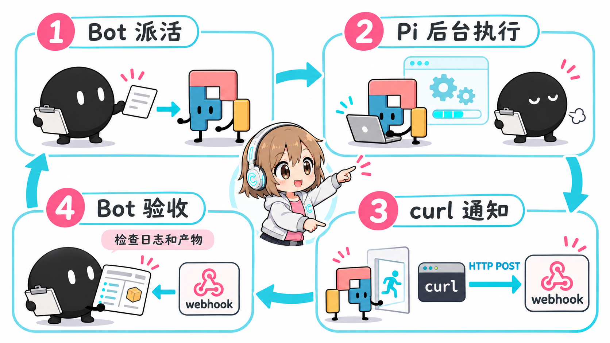
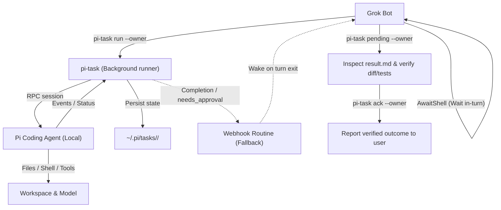

# GAP — Grokbot And Pi

English | [简体中文](README.zh-CN.md)

Let Grok Bot delegate heavy coding, batch file editing, and long document processing to a local **Pi coding agent** ([pi.dev](https://pi.dev)) running as a subagent on the same computer, keeping Grok Bot quota focused on planning and verification.

---

## Why GAP?

- **Save expensive Grok Bot quota**: Cloud bot allowances are costly and best spent on reasoning, task decomposition, and code review. Delegating multi-step execution (reading repositories, editing files, running tests) to Pi consumes your own model accounts (official API keys, custom relays, local Pi defaults, or private gateways).
- **Keep execution local and fast**: Pi runs on the same cloud Linux machine where the Bot operates, with direct access to local files and bash tools—no cross-network file syncing needed.
- **Reliable tracking and verification**: Unattended coding agents can freeze on machine sleep, hang on broken connections, or make wild assumptions. GAP provides a persistent task manager (`pi-task`), preflight connection recovery, idle-timeout guards, disaster prevention (`pi-guard`), and human-in-the-loop approvals.

---

## Architecture & Closed-Loop Workflow



GAP operates as a closed 4-step loop:



1. **Dispatch (`pi-task run`)**: Grok Bot drafts a concise, self-contained task specification and launches it in the background using `pi-task run <dir> '<prompt>' --session <name> --owner <BOT_ID> --notify-prefix <BOT>`.
2. **Wait in-turn (Avoid sleep freeze)**: The Bot **does not exit the current turn**. Because cloud agent host machines often sleep or restart when idle (which freezes or kills background worker processes), the Bot holds an extended blocking wait (`AwaitShell`, up to ~13 minutes) until Pi finishes. Waiting in-turn consumes virtually zero Bot model quota while keeping the machine awake.
3. **Webhook as fallback**: If the conversation turn does end prematurely, `pi-task` sends a lightweight HTTP POST notification (`{source, id, owner, state, exit_code}`) to the Bot's webhook routine upon completion or when an approval is required (`needs_approval`).
4. **Inspect, report, and Ack**: The Bot inspects `~/.pi/tasks/<ID>/result.md`, verifies git diffs, file artifacts, and test outputs first-hand, reports the findings to the user, and acknowledges the task with `pi-task ack <ID> --owner <BOT_ID>`.

> **Disk is the single source of truth**: All status records, event streams, and results are persisted under `~/.pi/tasks/<ID>/`. Webhooks are strictly a wake-up mechanism. If a notification packet drops, the Bot recovers all unreported outcomes simply by checking `pi-task pending --owner <BOT_ID>`.

---

## Quick Start

### 1. Automated Setup with Grok Bot (Recommended)

Simply send this repository link to your Grok Bot and ask it to configure itself following [AGENTS.md](AGENTS.md):

```text
Please read AGENTS.md at https://github.com/Chasen-Liao/grokbot-and-pi and set up GAP for me.
```

The Bot will verify Node.js (>= 22), check or install Pi CLI, run the installer, help configure your model source and Webhook routine, register skills, and run a smoke test.

### 2. Manual Installation

If you prefer to install manually on the Bot host:

```bash
# 1. Ensure Node.js >= 22 and install Pi CLI globally
node -v  # must be >= 22
npm i -g @earendil-works/pi-coding-agent
pi --version

# 2. Clone this repository and run the safe installer (installs to ~/tools/pi-call)
git clone https://github.com/Chasen-Liao/grokbot-and-pi /tmp/grokbot-and-pi
cd /tmp/grokbot-and-pi
./install.sh

# 3. Add tools to PATH (optional, e.g. in ~/.bashrc)
export PATH="$HOME/tools/pi-call:$PATH"

# 4. Verify minimal command execution
~/tools/pi-call/pi-task --help
```

---

## Daily Use

Grok Bot uses `pi-task` to manage delegated tasks. Key commands:

```bash
# 1. Dispatch a background task (always include --owner)
~/tools/pi-call/pi-task run /workspace/project "Refactor auth middleware and add tests" \
  --session auth-refactor \
  --owner YOUR_AGENT_ID \
  --notify-prefix GROKBOT \
  [--model provider/model] [--thinking medium] [--timeout 1800]

# 2. Follow up or resume in the same session
~/tools/pi-call/pi-task reply TASK_ID "Also cover the token expiration edge case" --owner YOUR_AGENT_ID

# 3. Check status, view recent logs, or cancel
~/tools/pi-call/pi-task status TASK_ID
~/tools/pi-call/pi-task log TASK_ID -n 30
~/tools/pi-call/pi-task cancel TASK_ID

# 4. Find pending tasks and acknowledge after first-hand verification
~/tools/pi-call/pi-task pending --owner YOUR_AGENT_ID
~/tools/pi-call/pi-task ack TASK_ID --owner YOUR_AGENT_ID

# 5. Handle approval requests intercepted by pi-guard (User decision only!)
~/tools/pi-call/pi-task approve TASK_ID REQ_ID --owner YOUR_AGENT_ID
~/tools/pi-call/pi-task deny TASK_ID REQ_ID --owner YOUR_AGENT_ID
```

### Writing a Good Task Specification

Grok Bot task specifications should be concise and strictly bounded:
1. **Goal**: What to do in 1-2 sentences with necessary context (Pi cannot see chat history).
2. **Artifact Path**: Absolute destination path for modified or created files.
3. **Definition of Done**: Clear, checkable acceptance criteria (e.g. tests pass, exports added).
4. **Strict Boundary**: E.g. *"Only edit files in `/workspace/project/src`. Do NOT delete any files. Do NOT git push."*
5. **Self-check**: *"Perform one self-check after implementation and stop; do not repeat checks endlessly."*

---

## Reliability & Resilience

- **Host Sleep & Restart Recovery**:
  Cloud Bot hosts sleep when idle, freezing Pi. By waiting in-turn using blocking `AwaitShell`, tasks complete without host sleep interruptions. If a host reboot interrupts an active job, `pi-task status` detects the orphaned PID and marks it `interrupted`. The Bot simply clears old state with `pi-task cancel <ID>` and resumes work seamlessly using `pi-task reply <ID> 'The machine rebooted; please resume where you left off...' --owner <BOT_ID>`.
- **Preflight Model Path Health Check (`pi-preflight`)**:
  When waking up from sleep, network connections (such as Tailscale tunnels) often accept TCP connections but hang on HTTP requests until failing with `UND_ERR_SOCKET`. Copy `bin/pi-preflight.example` to `~/tools/pi-call/pi-preflight` and adjust your health probe: `pi-task` automatically runs preflight before `run`, `reply`, and `approve`, restarting network tunnels if unhealthy. When Pi auto-retries a connection error, `pi-task` reruns preflight in parallel.
- **Idle Timeout Protection**:
  If Pi stops emitting RPC events for 300 seconds (configurable via `--idle-timeout <seconds>` or `PI_TASK_IDLE_TIMEOUT`), `pi-task` terminates the task with state `failed` (reason `idle timeout`) and sends a notification, preventing infinite hangs on dead model sockets.
- **Flexible Model Quotas**:
  Pi works with any model provider. Pass `--model <provider/model>`, configure `PI_TASK_MODEL`, or let Pi use its native default model and quota. If self-hosting a translation gateway such as Magpie on a VPS, **bind exclusively to Tailscale private IP addresses with authentication enabled—never expose ports to the public internet** (see [docs/quota.md](docs/quota.md)).

---

## Safety & Boundaries

- **Disaster Prevention Extension (`pi-guard`)**:
  Installed by default in `extensions/pi-guard.ts`. `pi-guard` narrowly intercepts catastrophic operations, including recursive deletes on system roots, user homes, or wildcards (`rm -rf /`, `/workspace`, `*`, `~`), `find -delete` on root/home, `mkfs`, and `dd of=/dev/`. Safe project builds (`rm -rf ./build`, `node_modules`) pass freely.
- **Human-in-the-Loop Approval Workflow**:
  When a dangerous command is intercepted, `pi-guard` logs it to `approvals.jsonl` with a unique request ID (`req`) and notifies the Bot with `state: "needs_approval"`. **The Bot must present the command to the user and is strictly forbidden from approving on its own.** Only after the human user explicitly agrees does the Bot run `pi-task approve <ID> <req> --owner <BOT_ID>`.
- **Restricted Operations Never Delegated to Pi**:
  Deleting important files, sending emails or external messages, online payments, public social posts, and `git push` **must never be handed to Pi**. Grok Bot handles these sensitive actions directly after separate user confirmation.
- **Secret Hygiene**:
  Notification credentials (`<BOT>_PI_NOTIFY_URL`, `<BOT>_PI_NOTIFY_KEY`) and authentication stores (`~/.pi/agent/auth.json`) are stripped from child processes and must never be printed to chat or recorded in task logs.

---

## Repository Layout

```text
grokbot-and-pi/
├── AGENTS.md                  # 7-step guide for Grok Bot automated self-configuration
├── bin/
│   ├── pi-task                # Main CLI wrapper with preflight support
│   ├── pi-task.mjs            # Task lifecycle runner (RPC, events, owner, approvals)
│   ├── pi-call.mjs            # Low-level one-shot RPC client
│   ├── pi-run                 # Synchronous quick-run wrapper
│   └── pi-preflight.example   # Example network/gateway health probe & reconnect script
├── extensions/
│   └── pi-guard.ts            # Lightweight disaster prevention extension (tool_call guard)
├── skills/
│   ├── grokbot-pi-setup/      # Skill for initial environment and connectivity setup
│   └── grokbot-pi-dispatch/   # Skill for task writing, dispatch, monitoring, and ack
├── routines/
│   └── pi-task-notify.md      # Webhook Routine prompt template for Grok Bot
├── docs/
│   ├── architecture.png       # Architecture diagram
│   ├── quota.md               # Model quota setup (official API, relays, Magpie gateway)
│   ├── security.md            # pi-guard specifications and human approval workflow
│   ├── setup-guide.md         # Detailed lifecycle, storage, and manual setup guide
│   └── pi-task-reference.md   # Complete pi-task CLI and environment reference
├── tests/
│   └── pi-guard.test.mjs      # Test suite for pi-guard interception rules
├── install.sh                 # Safe non-destructive installer
├── UPSTREAM-README.md         # Upstream project documentation (reference)
└── LICENSE                    # MIT License
```

---

## Documentation

- [Model Quota Setup Guide](docs/quota.md) — Official API keys, OpenAI relays, and private Magpie setups.
- [Security & Guard Workflow](docs/security.md) — `pi-guard` rule definitions and human-in-the-loop approvals.
- [Setup & Lifecycle Guide](docs/setup-guide.md) — Comprehensive environment configuration and task store internals.
- [pi-task CLI Reference](docs/pi-task-reference.md) — CLI flags, subcommands, exit codes, and environment variables.
- [Webhook Routine Template](routines/pi-task-notify.md) — Copy-paste prompt for configuring the Bot's Webhook Routine.

---

## Credits & License

This project is built upon and evolved from [robbin/grokbot-local-agent](https://github.com/robbin/grokbot-local-agent) under the [MIT License](LICENSE). See [UPSTREAM-README.md](UPSTREAM-README.md) for original background. Special thanks to robbin for the foundational architecture!
